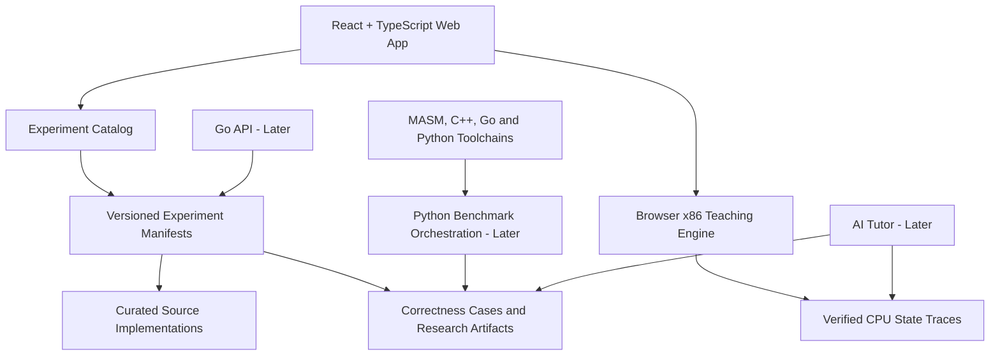

# Assembly Research Lab

**Explore how algorithms become machine instructions — then test what those instructions actually do.**

Assembly Research Lab is a planned **interactive computer architecture, programming-language comparison, and experimental research platform**. It connects high-level algorithms in **C++, Go, and Python** with **x86 Assembly** through guided instruction tracing, register and memory visualization, correctness tests, and reproducible investigations.

The platform is being designed with two connected experiences:

- **Learning Mode** — understand algorithms, registers, flags, branches, memory, and instruction execution through guided visual exercises.
- **Research Mode** — study compiler output, compare equivalent implementations, verify correctness, examine experimental results, and document performance findings.

> **Project status: Research and architecture planning.** The existing public repository, [Assembly-Complier-Reference](https://github.com/Andrez-Dev01/Assembly-Complier-Reference), currently contains a conceptual README, not a working simulator, benchmarking service, or hosted web application. Everything below is **proposed** unless explicitly described as existing. This document is a replacement README draft; it has **not been published to GitHub**.

> **Scope clarification:** The original project emphasized x86-64 assembly alongside C++, Python, and Go. Our academic MASM + Irvine32 experiments use **32-bit x86** on Windows. The expanded lab will document the two targets separately rather than treating them as identical environments.

## Table of contents

- [Why this project exists](#why-this-project-exists)
- [Who it's for](#who-its-for)
- [The two modes](#the-two-modes)
- [What a user will do](#what-a-user-will-do)
- [Feature scope and status](#feature-scope-and-status)
- [Architecture](#architecture)
- [Technology choices](#technology-choices)
- [Experimental methodology](#experimental-methodology)
- [First release — MVP](#first-release--mvp)
- [Development environments](#development-environments)
- [Getting started](#getting-started)
- [Safety and security](#safety-and-security)
- [Learning-first engineering](#learning-first-engineering)
- [Roadmap](#roadmap)
- [Documentation and collaboration](#documentation-and-collaboration)
- [Contributing](#contributing)
- [License](#license)

## Why this project exists

A programmer can understand what an algorithm *should* do without understanding how its behavior is represented by CPU instructions or shaped by a compiler and runtime. Classroom explanations of registers, pointers, stack frames, and machine code can be hard to connect to familiar high-level languages.

Assembly Research Lab aims to make those connections observable and testable:

1. Start with a clearly specified algorithm.
2. Inspect equivalent implementations in Assembly, C++, Go, and Python.
3. Step through a supported, educational x86 instruction sequence and inspect state changes.
4. Verify correctness using shared test cases.
5. Examine compiler output or reproducible measurements with explicit environment metadata.
6. Save or export findings, including uncertainties and limitations.

**The guiding question:** *How do language, implementation, toolchain, and hardware influence the way an algorithm executes?*

The project is **not a compiler** and should not be described as a full x86 CPU emulator. The initial instruction engine will intentionally support a small, documented subset of instructions.

## Who it's for

| Audience | Intended outcome |
| --- | --- |
| Computer science students | Understand CPU execution, algorithms, assembly, flags, and memory |
| Instructors | Demonstrate curated execution traces and assign reproducible experiments |
| C++ / Go / Python developers | Connect familiar source code to assembly and native program behavior |
| Systems learners | Practice instruction tracing, memory reasoning, and careful measurement |
| Researchers | Inspect experiment configurations, test results, and limitations |

**Initial audience:** students learning x86 assembly and fundamental algorithms. More advanced developer and classroom features are subsequent phases.

## The two modes

### Learning Mode — understand execution

**Proposed experience**

- Browse curated algorithms and lessons.
- See language implementations side by side.
- Follow a guided explanation of loops, comparisons, addresses, and control flow.
- Step forward or backward through a recorded instruction trace.
- Observe supported registers, relevant flags, and selected memory values.
- Review why a state transition happened.
- Complete short exercises and explain the result in your own words.

A possible learning exercise asks: **When does `CMP` set the zero flag, and how does `JE` use that result?** The visualizer should show a known instruction sequence and its verified state transition rather than invent an execution trace.

### Research Mode — examine the evidence

**Proposed experience**

- Open curated, versioned algorithm experiments.
- Inspect the experimental specification and shared test cases.
- Compare implementations and supported compiler/disassembly artifacts.
- Inspect benchmark data, distributions, and machine/toolchain metadata.
- Distinguish theoretical complexity from actual observations.
- Export an experiment manifest, findings, and data needed for replication.

A research example might compare Linear Search in Python, Go, C++, and 32-bit MASM. Its report must explain platform and toolchain differences and must **not** attribute every timing difference solely to the programming language.

## What a user will do

**Example: Binary Search** *(illustrative; not yet implemented)*

1. Choose **Binary Search** from the experiment library.
2. Read the algorithm contract: input is a sorted sequence and a target; output is the target index or “not found.”
3. Switch between MASM, C++, Go, and Python examples.
4. Play a supported x86 trace and watch comparisons and jumps update CPU state.
5. Run predefined correctness cases or review verified test output.
6. Switch to Research Mode to inspect compiler settings and benchmark metadata.
7. Export the experiment findings to continue studying or reproduce them locally.

## Feature scope and status

**Status legend:** `Documentation` = specified in project plans; `MVP target` = first implementation scope; `Later` = not planned for first release.

| Capability | Status | Notes |
| --- | --- | --- |
| Cross-language concept reference | Documentation | Current repository describes the original comparison idea |
| Curated algorithm catalog | MVP target | Linear Search, Binary Search, Bubble Sort |
| Assembly / C++ / Go / Python examples | MVP target | Equivalent algorithm specifications |
| Instruction-by-instruction state viewer | MVP target | Limited and verified x86 subset |
| Register, flags, and selected memory views | MVP target | Educational model; not full hardware simulation |
| Shared correctness tests | MVP target | Required before benchmark comparison |
| Reproducible experiment manifests and exports | MVP target | Versioned inputs, environment and output |
| Precomputed research data viewer | MVP target | Clearly labeled measured vs illustrative data |
| Native compiler-output comparisons | Later | Toolchain adapters and disassembly tooling |
| Live benchmark execution | Later | Curated workloads and isolated runners |
| AI tutor | Later | Grounded hints, explanations, evaluations |
| Accounts, saved progress, classroom tools | Later | Authorization and retention required |
| Public SDK / MCP interfaces | Later | No existing server or published SDK |
| Arbitrary uploaded code execution | Not in MVP | Requires a separate isolation/security design |

No installation, benchmark result, security certification, or live application is claimed until verified in code and tests.

## Architecture

The design favors one curated experiment format shared by both modes.



### Core boundaries

**Web UI:** presents lessons, code comparisons, traces, and research reports. The first release should work with curated local data without requiring a login.

**x86 teaching engine:** a small deterministic instruction interpreter with explicit CPU state and testable instruction semantics. It will support a documented subset, not execute arbitrary Windows programs.

**Experiment specifications:** versioned manifests that define an algorithm, valid inputs, expected outputs, supported implementations, environments, and artifact references.

**Research tooling:** local scripts that compile or run trusted curated implementations, collect correctness and benchmark data, and produce reproducible artifacts. Machine-specific benchmarks stay associated with their environment metadata.

**Go API (later):** serves catalogs, reports, and persistent data if the product needs hosted accounts or other backend operations; initially avoid a database solely to display static lessons.

**AI assistance (later):** explains traces and experimental findings with references to known data. It must distinguish measured facts from hypotheses and never execute untrusted code just because a model asks it to.

### Proposed monorepo structure

The following is a **target layout**, not an existing tree:

```text
assembly-research-lab/
├── README.md
├── AGENTS.md
├── apps/
│   └── web/                      # Interactive Learning and Research Mode
├── packages/
│   └── x86-teaching-engine/      # Small, tested interpreter and trace model
├── experiments/
│   ├── linear-search/
│   │   ├── experiment.json
│   │   ├── masm/
│   │   ├── cpp/
│   │   ├── go/
│   │   ├── python/
│   │   └── findings.md
│   ├── binary-search/
│   └── bubble-sort/
├── research/
│   ├── runner/
│   ├── measurements/
│   └── reports/
├── services/
│   └── api/                      # Added when a Go backend is warranted
├── docs/
│   ├── ARCHITECTURE.md
│   ├── PRODUCT_REQUIREMENTS.md
│   ├── RESEARCH_METHODOLOGY.md
│   ├── SECURITY.md
│   ├── decisions/
│   └── engineering-log/
└── .github/
    └── workflows/
```

## Technology choices

| Area | Preferred technology | Why |
| --- | --- | --- |
| Interactive frontend | React, TypeScript, Vite | Responsive, testable instructional interfaces |
| Code editor and viewer | Monaco Editor, evaluated for actual needs | Highlighted source, selection and navigation |
| Teaching interpreter | TypeScript | Deterministic, browser-local state stepping |
| Native algorithm implementations | C++, Go, Python, 32-bit MASM | Compare language and execution models |
| Research automation | Python | Reproducible experiments and data processing |
| Hosted API, when needed | Go | Service boundaries, experiment APIs and jobs |
| Persistence, when needed | PostgreSQL and artifact storage | Saved users, experiments and runs |
| Testing | Unit tests, integration tests and browser tests | Correctness and trace validation |
| CI/CD | GitHub Actions, dependency and secret scanning | Repeatable validation and safer changes |

The stack is proposed. Only dependencies needed for the next verified milestone should be introduced.

## Experimental methodology

The research portion is more than a chart comparing language runtimes.

**Every accepted experiment should provide:**

- A written algorithm specification and assumptions.
- Equivalent test inputs, outputs, edge cases, and correctness evidence.
- Source files and exact code revisions.
- OS, CPU, target ISA/bitness, compiler/interpreter versions, flags, and dependencies.
- Input sizes, seeds, warm-up approach (if appropriate), and repetition count.
- Raw measurements and a report of variability; not just one timing number.
- A discussion of confounders, measurement overhead, and limitations.

### What we will keep distinct

1. **Big-O analysis:** mathematical growth under specified assumptions.
2. **Educational CPU simulation:** a model of supported architectural state changes.
3. **Compiler-generated assembly:** output for a specified target/compiler/configuration.
4. **Native runtime measurements:** observations from actual programs and hardware.
5. **AI explanations:** interpretations that require supporting references and verification.

Compiler or emulator estimates should not be presented as measured CPU performance. Comparing 32-bit MASM/Irvine32 against 64-bit Linux implementations is educational but is **not** a controlled language-only performance comparison.

## First release — MVP

**Goal:** Enable a student to complete one curated experiment from explanation through instruction trace and verified output.

### Initial algorithms

1. **Linear Search** — loop control, compares, and memory access.
2. **Binary Search** — branches, midpoints, bounds and search invariants.
3. **Bubble Sort** — nested loops, comparisons, swaps and array indexing.

### Acceptance criteria

- Students can browse three experiments and inspect all four language implementations.
- A curated x86 sequence can be stepped forward and backward deterministically.
- Registers, relevant flags and selected memory changes match tested expectations.
- The result of each algorithm is checked against shared correctness cases.
- Available research artifacts identify their provenance and runtime environment.
- A report can be exported with the algorithm, inputs, evidence and limitations.
- Critical interactions are keyboard-accessible, responsive, and tested.
- No public arbitrary-code execution endpoint is required for the MVP.

The first end-to-end vertical slice will be **Linear Search**, followed by Binary Search and Bubble Sort.

## Development environments

### Windows: MASM / Irvine32

The coursework-compatible track uses **32-bit x86** MASM with Irvine32 on Windows. Editor choice is independent of the build tools; a full Visual Studio IDE is not required simply to edit assembly source. Exact assembler, linker and Irvine32 setup instructions will be documented after the toolchain is validated.

### Ubuntu: native experiments

The Linux research track will use supported C++ compilers, the Go toolchain, Python, testing and profiling tools. Each experiment will document exact versions and target architecture.

### Browser: teaching visualizer

Curated lessons and educational instruction traces will run in the browser. These traces must be labeled as simulations unless they are captured from a separately documented native execution environment.

## Getting started

**There is not yet a runnable Assembly Research Lab application.** The currently published repository contains the original concept README. Please do not assume commands in this proposed tree work today.

To examine the existing starting point:

```bash
git clone https://github.com/Andrez-Dev01/Assembly-Complier-Reference.git
cd Assembly-Complier-Reference
```

Once the first experiment and UI are implemented, this section will contain **tested** prerequisites, installation, execution, build, and test commands for Windows and Ubuntu.

## Safety and security

- Start with vetted, curated experiments and browser-local simulation.
- Do **not** build a public service that compiles or executes arbitrary user-supplied native code in the MVP.
- Any future code execution service will require deliberate isolation, CPU/time/memory quotas, filesystem and network restrictions, auditing, and security review.
- Never commit secrets, private credentials, paid textbook scans, or copyrighted course materials without authorization.
- Scan dependencies and committed content; require relevant checks before merging.
- Separate user-provided source data from instructions to the AI assistant.
- Treat a model explanation as a hypothesis unless supported by inspected evidence.

A successful security scan does not guarantee the absence of vulnerabilities. Threat modeling, review, and testing remain required.

## Learning-first engineering

This project is also an engineering education project. AI tools such as Cursor should help teach systems concepts, not silently manufacture unreviewed implementations.

For every meaningful feature:

1. Define **what is being built and why** (request record).
2. Explain the underlying CS concepts and propose an implementation design.
3. Let the developer implement important logic; use targeted guidance and review.
4. Test instruction semantics and observable behavior, including edge cases.
5. Record alternative designs and decisions (ADR).
6. Record what was verified, what failed, and what remains open (build log).
7. Link the experiment to personal notes in a separate, private Obsidian project vault.

Repository documentation should remain authoritative for shared engineering facts. Private study notes should not be automatically published.

## Roadmap

| Phase | Planned milestone | Completion evidence |
| --- | --- | --- |
| 0 | Define experiment manifests, research methodology, and x86 state model | Reviewed specifications and tests |
| 1 | Implement three algorithms in four languages | Equivalent correctness tests pass |
| 2 | Build a limited x86 teaching engine | State traces pass reference cases |
| 3 | Deliver Learning Mode UI | A student completes guided Linear Search |
| 4 | Deliver Research Mode reports and reproducible runners | Results include raw data and provenance |
| 5 | Explore AI explanations and compiler tooling | Evaluations demonstrate grounded behavior |
| 6 | Harden, deploy, and onboard students | Security, accessibility and usability checks pass |

No roadmap item should be marked completed before the implementation and verification evidence exists.

## Documentation and collaboration

Planned project documents:

- `docs/ARCHITECTURE.md` — modules, data flow, toolchains and trust boundaries.
- `docs/PRODUCT_REQUIREMENTS.md` — user journeys and acceptance criteria.
- `docs/RESEARCH_METHODOLOGY.md` — experimental controls and reporting conventions.
- `docs/SECURITY.md` — threats, policies and safe execution boundaries.
- `docs/decisions/` — architecture decision records.
- `docs/engineering-log/` — verified progress, issues and testing evidence.
- `AGENTS.md` — persistent agent instructions and learning rules.

Personal Obsidian notes can reference experiment IDs (such as `ARL-002`) and concept pages for CPU flags, pointers, arrays, calling conventions and complexity.

## Contributing

Contributions are welcome as the project matures, particularly original learning exercises, correctness tests, explanations, and reproducible experiments. Before submitting changes, contributors should:

1. Check the current repository status and open issues.
2. Explain what the change demonstrates and why it belongs.
3. Provide source and reproducibility metadata for experiments.
4. Add tests or verification evidence where applicable.
5. Avoid uploading proprietary educational materials or unlicensed code.

A formal `CONTRIBUTING.md` and contributor workflow will be added before opening the project to regular external contributions.

## License

**A software license has not yet been selected.** Until one is added, do not assume the repository or its code can be redistributed or reused under an open-source license. Code licenses and educational content licenses may need separate consideration.

---

*Assembly Research Lab is being designed to make computer architecture observable, algorithms testable, and performance claims reproducible.*
